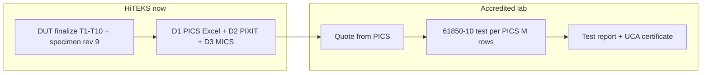

# DUT lab finalize + path to UCA certificate

**Document ID:** CCLI-LAB-DUT-CERT-001  
**Date:** 2026-10-09  
**RAG source_id:** `ccli-lab-dut-finalize-cert-path`  
**Specimen:** TG544 · `ccli 0.1.0-r52` · CID History **rev 9** — [LAB_SPECIMEN_VERSION.md](LAB_SPECIMEN_VERSION.md)

**Scope of this note:** Close **DUT / Test Suite Pro bench** for the current specimen. Clarify what **you** must finish vs what the **accredited lab** executes for an **IEC 61850-10 / UCA certificate** (O.15).

---

## 1. Two different “done” meanings

| Milestone | Who | Outcome |
|-----------|-----|---------|
| **A — DUT lab finalize (now)** | HiTEKS on TG544 + TSP | Traceable evidence that **PICS first-pass** claims work on **3782 TLS**; matrix □ closed or PART+waiver |
| **B — UCA / O.15 certificate** | **Accredited test house** (after quote) | Formal **61850-10** test report + certificate against **submitted PICS/PIXIT/MICS** |

**T1–T10 in Test Suite Pro** satisfies **most of milestone A** (Tier 1). It does **not** replace milestone B.

---

## 2. DUT finalize checklist (do before “DUT test closed”)

### 2.1 DUT image (blocking Compare Value rows)

| □ | Check | Pass criteria |
|---|--------|----------------|
| □ | Stop TesPro **`iec61850service`** / **`iec61850d`** | Single owner of **3782** |
| □ | **One** `ccli` process | `ps \| grep ccli` → 1 daemon |
| □ | Deploy **`/etc/ccli/icd/lab_tg544_eth_a.cfg`** | SHA **`E3285E8F9B692C52DBFE6B141B308513ABCACA00F56F8702F0EC757478D77E49`** · URCB **159** · BRCB **191** · `configRev` **20261009** |
| □ | Restart **`/etc/init.d/ccli restart`** | `3782` + `2404` listen |
| □ | Record **`ccli --version`** + deploy manifest | Same string on every `TSP_*` header |

Evidence template: [PREFLIGHT_DUT_2026-10-09_200828.txt](../evidence/testsuite-pro/inbox/PREFLIGHT_DUT_2026-10-09_200828.txt)

### 2.2 TSP Tier 1 (you reported T1–T10 complete)

Cross-check evidence under `lab/evidence/testsuite-pro/inbox/`:

| TSP | Gate | Evidence (2026-10-09) | Status |
|-----|------|------------------------|--------|
| T1-01 | Connect TLS | `TSP_P3_01_CONNECT_*.txt` | Close stub → **PASS** if session green |
| T1-02 | Compare | `TSP_P3_COMPARE_*.txt` + xlsx + [waivers](../evidence/testsuite-pro/inbox/TSP_P5_COMPARE_WAIVERS.md) | **PASS (scoped)** |
| T1-03 | Browse 31 LN | `TSP_P3_03_BROWSE_*.txt` | Close stub |
| T1-04 | Read PdC | `TSP_P3_03_READ_PdC_*.txt` | Close stub |
| T1-05–06 | URCB 4 s | `TSP_P3_03_REPORT_*` | Close stub · Δt 3900–4100 ms |
| T1-07 | Wlim | `TSP_P3_04_OPERATE_Wlim_*.txt` | Close stub |
| T1-08 | WSd | `TSP_P3_04_OPERATE_WSd_*.txt` | **PASS** |
| T1-09 | 15 s fallback | `TSP_P3_05_FALLBACK_*.txt` | **PASS** |
| T1-10 | Reconnect | `TSP_P3_01_RECONNECT_*.txt` | **PASS** |

**Optional third Compare:** `3.xlsx` / `TSP_P3_COMPARE_AFTER_REV9_*.xlsx` after rev 9 cfg — target **0 Value**, ~60 PdC waive (**TSP-SCL-01**).

### 2.3 Minimum beyond T1–T10 for a **defensible** DUT pack (still internal)

| □ | Item | Why | Skip if |
|---|------|-----|--------|
| □ | **chrony** \|offset\| ≤ 100 ms | Annex **T.3.3.4.5** · matrix P3-11 | Already in `TSP_P5_FULLCIRCLE_TLS_2026-10-09.txt` § step 1 |
| □ | **SCL Verify** 0 errors | D5 / lab intake | `TSP_OFF_SCLVERIFY_2026-10-09.txt` **PASS** |
| □ | **`dido_v2` after Wlim** | O.9.2.2 actuation trace | One SSH log line in evidence |
| □ | **Tier 3** T3-01…03 (TLS fail, viewer read/deny) | PICS security **M** rows | Lab may re-run; recommended before ship |

**Explicitly out of first-pass 61850 PICS:** BRCB, GOOSE, File, SG (matrix Tier 4) — no DUT block for cert quote if PICS stays **N/A**.

### 2.4 Phase 7 on **this** DUT build (needed for **O.15 / ship**, not for T1–T10)

| ID | Action | Evidence |
|----|--------|----------|
| P7-01 | `ccli --event-wrap-test` · `--event-clear` must **fail** | `P7_01_WRAP_*` on **r52** |
| P7-02 | `ccli --event-dump --count 20` | `P7_02_DUMP_*` |
| P7-11 | Run [P7-11 script](../evidence/phase7/P7-11_DSO_DEMO_SCRIPT.md) | `P7-11_DSO_DEMO_*.txt` |

See [P7_README.md](../evidence/phase7/P7_README.md) — software **HAVE**; **signed run on r52** still open.

---

## 3. Path to **certificate** (what gets you the paper)

| Step | Deliverable | Status (2026-10-09) |
|------|-------------|---------------------|
| 1 | **PICS (D1)** pasted from [PICS_FILL.md](PICS_FILL.md) → Excel → lab | **TODO** — blocks **quote** |
| 2 | **PIXIT (D2)** + **MICS (D3)** | Markdown **HAVE**; Word paste **TODO** |
| 3 | **CID (D5)** + [LAB_CONFIG_GUIDE.md](LAB_CONFIG_GUIDE.md) | **HAVE** · cert freeze trim per [CID_PICS_ALIGNMENT.md](CID_PICS_ALIGNMENT.md) |
| 4 | **TICS (D4)** | After lab gives TISSUES date |
| 5 | **62351-3 PID (D7)** | If lab quotes TLS + 61850 together |
| 6 | **Ship DUT** or lab visit with frozen **firmware + CID** | After P7-01/11 PASS on release image |
| 7 | **Lab execution** | Full **61850-10** programme — **not** TSP Annex T sequencer alone |
| 8 | **Certificate** | Issued only on lab **PASS** vs submitted PICS |

**You will get a certificate when:** the lab runs the contracted test programme and your device **passes** against the **final** PICS/PIXIT (no open **M** failures). Internal TSP logs are **supporting evidence**, not the certificate.

---

## 4. Risks to cert (manage before submission)

| Risk | Mitigation |
|------|------------|
| PICS **M** claims BRCB/GOOSE/File from raw CID | Keep **N/A** in PICS; align [CID_PICS_ALIGNMENT.md](CID_PICS_ALIGNMENT.md) |
| Specimen **cfg** ≠ repo rev 9 | Deploy pinned SHA; re-Compare |
| **Dual ccli** / TesPro on **3782** | Preflight stop list |
| PICS firmware ≠ DUT | One **`ccli_pkg`** on Cover and all logs |
| Compare PdC PPV/A ~60 rows | Waive **TSP-SCL-01** + browse proof |

---

## 5. Sign-off criteria (DUT lab finalize — milestone A)

**PASS when:**

1. Section **2.1** all □ checked on **r52** + rev **9** cfg.  
2. Section **2.2** every T1 has **PASS** in evidence (not PENDING stubs).  
3. [LAB_REQUIREMENT_TEST_MATRIX_2026-10-09_DUT.md](LAB_REQUIREMENT_TEST_MATRIX_2026-10-09_DUT.md) has no open **M** row without evidence or waiver.  
4. PM accepts **G1** (PICS Excel to lab) as parallel track for milestone B.

**Certificate (milestone B)** is tracked separately in [2026-10-08_UCA_Document_Phase_Checklist.md](2026-10-08_UCA_Document_Phase_Checklist.md).

---

## Related

- [LAB_REQUIREMENT_TEST_MATRIX.md](LAB_REQUIREMENT_TEST_MATRIX.md) · [LAB_SESSION_2026-10-09_ANNEX_RUNBOOK.md](LAB_SESSION_2026-10-09_ANNEX_RUNBOOK.md)  
- [TSP_TEST_IDENTIFICATION_POST_CONNECT.md](../evidence/testsuite-pro/TSP_TEST_IDENTIFICATION_POST_CONNECT.md)  
- [TSP_PHASE1_SESSION_INDEX_2026-10-09.md](../evidence/testsuite-pro/inbox/TSP_PHASE1_SESSION_INDEX_2026-10-09.md)
