# Unified certification test roadmap — 5-LN product · two-PC bench

**Document ID:** CCLI-LAB-UNIFIED-ROAD-001  
**Revision:** 1.1  
**Date:** 2026-10-14  
**TestPro logs:** [LAB_UNIFIED_TSP_5LN_EXECUTION.md](LAB_UNIFIED_TSP_5LN_EXECUTION.md)
**RAG source_id:** `ccli-lab-unified-cert-test-roadmap`  
**Matrix:** [LAB_UNIFIED_CERT_TEST_MATRIX.md](LAB_UNIFIED_CERT_TEST_MATRIX.md) · CSV: [LAB_UNIFIED_CERT_TEST_MATRIX.csv](LAB_UNIFIED_CERT_TEST_MATRIX.csv)  
**Specimen:** [PRODUCT_SPECIMEN_5LN.md](PRODUCT_SPECIMEN_5LN.md)

Executable order for **your hardware**: **PC-B** (Test Suite Pro, LAN1 only) · **PC-A** (LAN2 104, LAN3 meter, USB RS485 mock) · **TG544 DUT** · **EMT432** (or RTU-only day).

---

## Requirements

| ID | Requirement |
|----|-------------|
| REQ-ROAD-HW-001 | PC-B runs **only** TSP on LAN1 `192.168.10.10` → DUT `192.168.10.1:3782` |
| REQ-ROAD-HW-002 | PC-A runs **104**, Modbus probe/slave, SSH — **never** TSP on LAN1 |
| REQ-ROAD-HW-003 | RS485 USB: A→A1, B→B1, common GND ([P5_A1B1_RS485_HW_MAP.md](../evidence/phase5/P5_A1B1_RS485_HW_MAP.md)) |
| REQ-ROAD-SPEC-001 | First run specimen = **5-LN** product CID ([PRODUCT_SPECIMEN_5LN.md](PRODUCT_SPECIMEN_5LN.md)) |
| REQ-ROAD-EV-001 | One `.txt` + `.pcapng` per TSP row via `tsp-evidence-logger.ps1` |
| REQ-ROAD-RAG-001 | After session, ingest: `ingest-testsuite-pro.ps1` + `ingest-product-deploy-rag.ps1` |

---

## Bench topology (accurate IP map)

```text
  PC-B 192.168.10.10  ──LAN1──  DUT 192.168.10.1:3782  (MMS TLS / TSP)
  PC-A 192.168.1.183  ──LAN2──  DUT 192.168.1.130:2404 (IEC 104)
  PC-A 192.168.30.10  ──LAN3──  DUT 192.168.30.1      (plant)
  EMT432 192.168.30.50:502 (default doc) OR 192.168.178.250 (Chronos SN bench)
  PC-A COM5 USB-RS485 ──A1/B1── DUT /dev/ttyS1        (SUN2000 RTU mock)
```

**Before Phase 0b:** pick LAN3 profile · run `modbus_emt432_tcp_probe.py` if using TCP meter · start **SUN2000** via `lab/start-bench-plant.ps1` on COM5 (not `--huawei` RTU slave).

Normative bench doc: `ccli-tsp-two-pc-bench-runbook`

---

## Timeline (one lab day)

```mermaid
gantt
    title Unified cert test day (5-LN specimen)
    dateFormat HH:mm
    axisFormat %H:%M
    section PC-A
    Phase 0b plant up           :a1, 09:00, 45m
    104 optional                :a2, after a1, 60m
    P7 SSH                      :a3, 09:30, 90m
    section PC-B
    Phase 0 prep                  :b0, 09:00, 30m
    Phase 1 T1 core               :b1, 09:30, 120m
    Phase 2 P5 full circle        :b2, after b1, 45m
    Phase 3 T3 cyber              :b3, after b2, 60m
    section Repo
    Phase 6 export ingest         :c1, 16:00, 30m
```



---

## Phase roadmap → matrix row IDs

| Phase | Who | Objective | Unified rows | Legacy docs |
|-------|-----|-----------|--------------|-------------|
| **0 Prep** | Both | Field pack, NIC scripts, single `ccli`, stop `iec61850service` | U-P0-01…08 | Runbook Phase 0 |
| **0b Plant** | PC-A | Meter + RS485 mock + non-zero P if needed | U-P0b-01…05 | Runbook Phase 0b |
| **1 MMS core** | PC-B | T1-01…10 on **5-LN** CID | U-T1-01…10 | Functional matrix |
| **2 Annex T** | PC-B + PC-A | **5-LN** P5 scope only ([P5_FULLCIRCLE_5LN_SCOPE.md](P5_FULLCIRCLE_5LN_SCOPE.md)) | U-P5-01 | Not 31-LN sequencer |
| **3 Cyber** | PC-B | T3-01…05 + D7 internal | U-T3-01…09, U-D7-01…06 | Cyber matrix §2–§3 |
| **4 104** | PC-A | O.13 monitor-only (not 61850 PICS) | U-P4-01…02 | Phase 4 runbook |
| **5 O.14 logger** | PC-A SSH | P7-01/02/04/11 | U-P7-01…04 | phase7 README |
| **6 Closeout** | Both | USB → inbox, □ matrix, RAG ingest | U-CLO-01…03 | EVIDENCE_PER_TEST_PROTOCOL |
| **DOC** | Eng | D1–D7 submit pack | U-DOC-01…08 | UCA checklist |
| **ACC** | Accredited labs | UCA · 100-3 · 62443 · 61557-12 | U-ACC-01…06 | DNV readiness |

---

## Pre-flight gate (do not skip)

| □ | Gate | Pass |
|---|------|------|
| □ | [PRODUCT_SPECIMEN_5LN.md](PRODUCT_SPECIMEN_5LN.md) cfg on DUT | SHA matches pin table |
| □ | PICS Cover will state **5-LN** + same `ccli --version` as session | REQ-LAB-MTX-003 |
| □ | TSP imports **product** CID from field pack `cid/` | Not 31-LN unless waiver documented |
| □ | `stage-tsp-field-pack.ps1` run on PC-B | `00_UNIFIED_CERT_MATRIX.md` present |
| □ | Cyber Track D (product yaml) | No `:102` cleartext in release yaml audit |

---

## DUT yaml selection (your bench)

| Priority | Yaml | When |
|----------|------|------|
| **1** | `lab_tr400_phase4_eth_b_ttyS1.yaml` | Default: TSP + 104 + **USB RS485** mock same day |
| **2** | `lab_tr400_phase4_emt432_lan3_tcp.yaml` | When EMT432 on LAN3 probed OK |
| **3** | `lab_tr400_phase1_regulation.yaml` + ttyS1 | TSP-only day, RTU P |

---

## Knowledge gaps

| Area | Current | Required |
|------|---------|----------|
| 5-LN CID/cfg in git | **TODO** | Block T1-02 sign-off |
| 62351-100-4 same visit | Ask lab | Flip U-ACC-04 formal column |
| 61557-12 / 61439 | Programme OPEN | Schedule external lab |

---

## Risks

| ID | Description | Mitigation |
|----|-------------|------------|
| R-ROAD-001 | TSP on PC-A pollutes LAN1 | Enforce PC-B-only TSP |
| R-ROAD-002 | Wrong LAN3 subnet vs meter | Probe script before yaml deploy |
| R-ROAD-003 | 31-LN evidence mixed with 5-LN cert | Separate session header + specimen doc |

---

## Verification

| Requirement | Test | Pass |
|-------------|------|------|
| REQ-ROAD-SPEC-001 | Compare on 5-LN | 0 LN/DO MISSING; Value per product waiver policy |
| REQ-LAB-MTX-001 | All PICS **M** rows | □ or PART+waiver in unified matrix |
| REQ-CYB-O-001 | P7-07 | Accredited 100-3 report ID on U-ACC-02 |

---

## RAG ingest (after session)

```powershell
powershell -File scripts\ingest-testsuite-pro.ps1
powershell -File scripts\ingest-product-deploy-rag.ps1
```

**Probe:** `ccli-lab-unified-cert-test-matrix` · `ccli-lab-unified-cert-test-roadmap` · `ccli-product-specimen-5ln`

**Keywords:** `roadmap`, `unified`, `5-LN`, `two-PC`, `TSP`, `EMT432`, `RS485`, `O.15`
